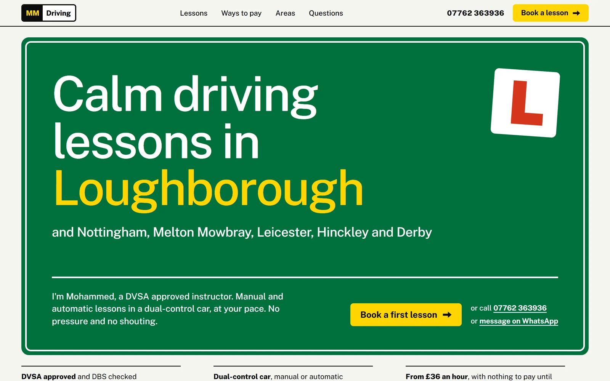
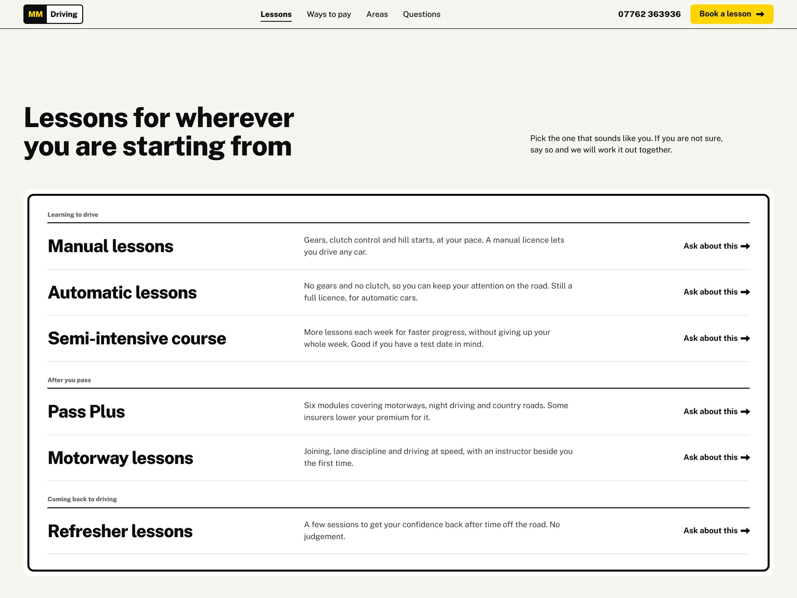
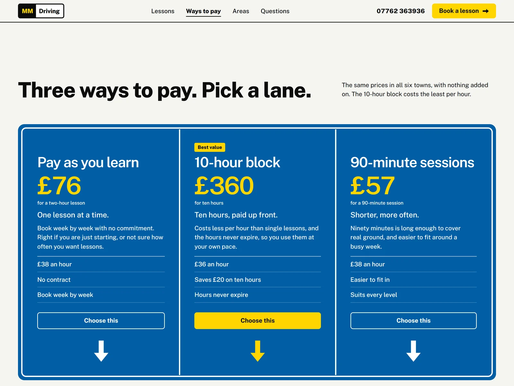
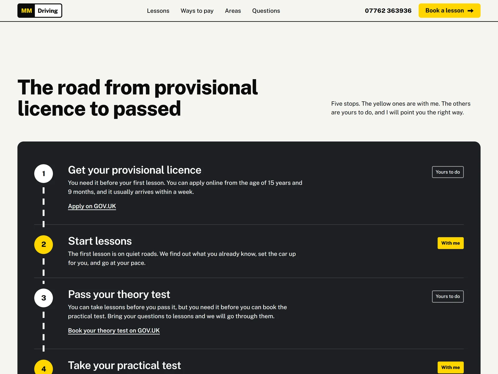
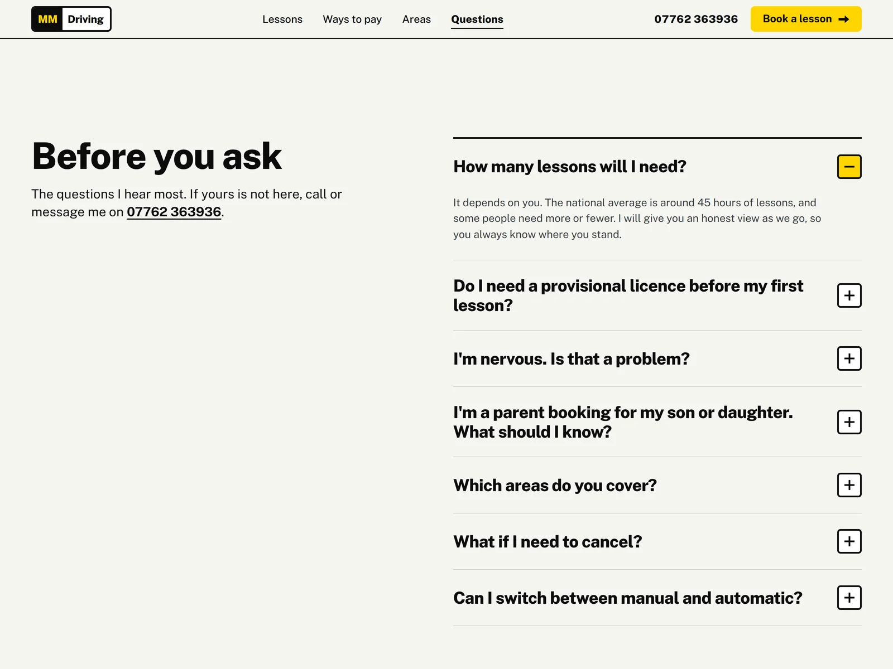

# MMDriving

**[Visit the site](https://mmdriving-snowy.vercel.app)**

A website for an independent, DVSA-approved driving instructor covering Loughborough, Melton Mowbray, Nottingham, Leicester, Derby and Hinckley. It's real client work: I planned the page structure, designed it, wrote the copy and built it, working with the instructor as we went. It's still being finished with the client.




---

## The brief

A nervous learner, or their parent, needs to trust an instructor before they'll book. Most local driving school sites are loud, cluttered and hard to read on a phone. The instructor wanted a site that feels calm and competent, ranks for the towns he covers, and turns a visit into a booked first lesson.

---

## What I built

- **One page, in the order a learner decides.** What this is and where, who is teaching me, what lessons there are, how I pay, whether you come to my town, what the whole process is, my worries, and how to book.
- **The first screen is a road sign.** It says what, where and how to book, and nothing else.
- **Booking is always one tap away.** The header carries the phone number and "Book a lesson". On phones, a bar at the bottom of the screen does the same job once the first button has scrolled away.
- **Choosing carries through.** Pick a lesson or a way to pay anywhere on the page and it arrives in the enquiry form already filled in.
- **A form that asks for just enough.** Name and phone number are needed; town, lesson and a note are optional. Mistakes are explained in plain words, and if sending fails nothing typed is lost.
- **The whole road to a licence.** Five stops from provisional licence to after the test, with the official GOV.UK links, showing which parts are with the instructor.
- **Every town named.** Drawn as the roundabout sign every learner has to read, and listed as text for search.

---

## Design decisions

### It looks like the road
The whole site is built from the British road sign system: one typeface, green panels with a white inner line, a motorway gantry for the three ways to pay, countdown markers before the booking form. Every learner is studying these signs for their theory test, and the system was designed to be read at a glance by someone under pressure, which is exactly who is looking at this page. The research behind it, and a list of patterns the site is not allowed to use, are in [docs/REDESIGN-RESEARCH.md](docs/REDESIGN-RESEARCH.md).

### Nothing is claimed that has not been confirmed
There is no pass rate, no star rating, no "spaces left this week" and no prices on the page, because the client has not confirmed them yet. The page earns trust by being specific, useful and plain instead.

### Designing inside a real constraint
There was no budget for a server, so there isn't one. The site is fully static and the enquiry form goes through Formspree. That one decision shaped everything else: no accounts, no personalisation, nothing that assumes infrastructure the client isn't paying for.

### Content in one place
Every piece of text on the site, from prices to FAQ answers, lives in `src/data/siteData.ts`. Updating a price or adding a town means editing one file, not hunting through components.

---

## Stack

| Layer | Technology |
|---|---|
| Framework | React 19 with Vite |
| Language | TypeScript |
| Styling | CSS Modules with design tokens as CSS custom properties |
| Fonts | Clash Display and Cabinet Grotesk from Fontshare |
| Forms | Formspree |
| Hosting | Vercel |

---

## Running it locally

```bash
git clone https://github.com/Cole-Crawley/mmdriving.git
cd mmdriving
npm install
npm run dev
```

Open [http://localhost:5173](http://localhost:5173).

---

## Project structure

```
src/
  data/siteData.ts    All site content: services, prices and FAQs (reviews are held back until real ones arrive)
  types/              Types for that content
  sections/           One component per page section, in page order
  components/         Navbar, footer and the floating call-to-action bar
  hooks/useReveal.ts  Reveals sections as they scroll into view
```

---

## Screenshots

Six kinds of lesson set out like a stack sign, one destination per row:



Three ways to pay as a motorway gantry, with one clear recommendation and no hidden terms:



The road from provisional licence to passed, and which stops are with the instructor:



The questions a nervous learner, or a parent, has before they call:



*Designed and built by [Cole Crawley](https://colecrawley.com).*
